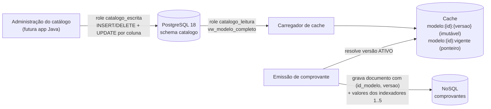
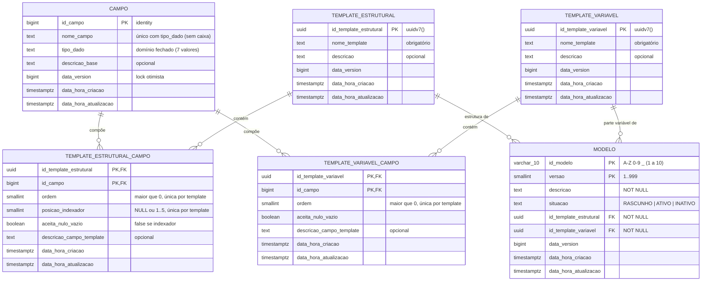
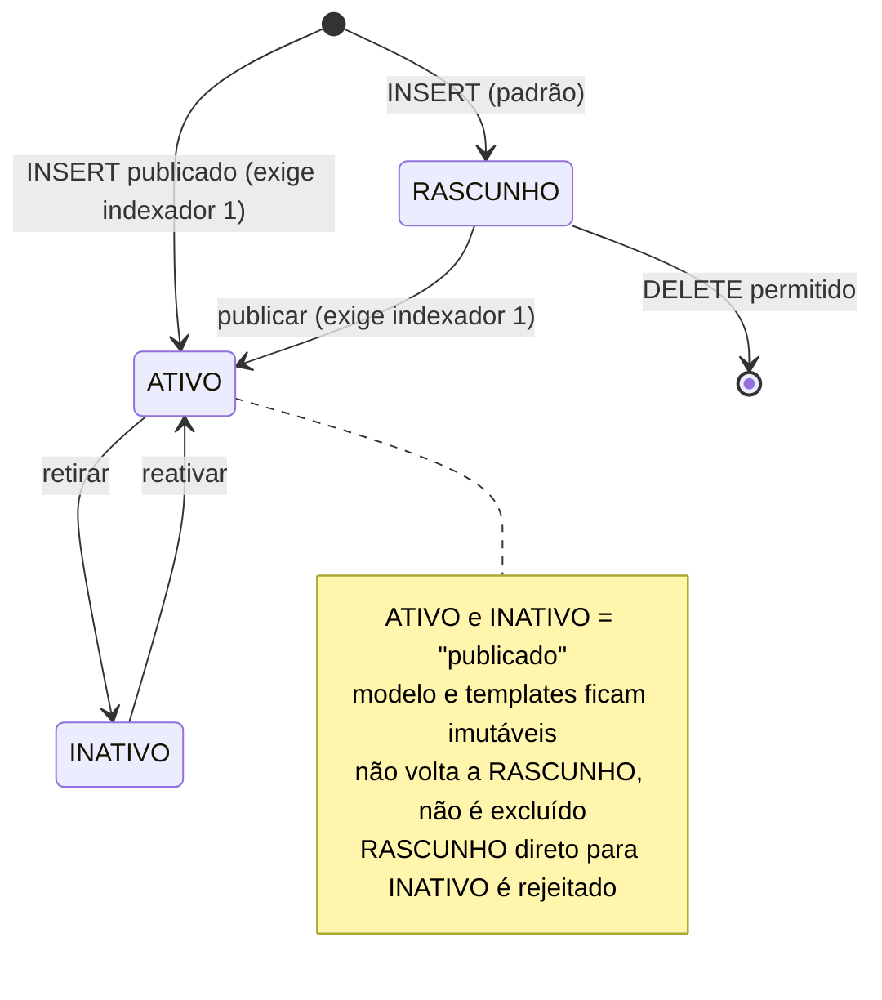
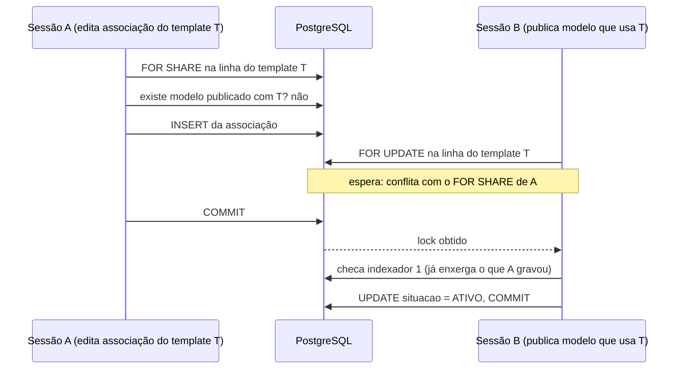

# Catálogo de Modelos de Comprovante — Explicação da Modelagem e Aderência ao `docs/`

> Atualizado em 2026-11-22, depois da change `corrigir-catalogo-modelos-comprovante`. Diagramas em Mermaid (skill `gerar-diagramas`).
>
> **Fontes**
>
> | Papel | Arquivo |
> |---|---|
> | Proposta (requisito de negócio) | `docs/modelagem-dados-para-modelo-de-comprovante.txt` |
> | Proposta (cardinalidade) | `docs/cardinalidade-modelo-comprovante.png` |
> | Implementação | `infra/local/postgres/migrations/v1.0.00` … `v1.0.07` |
> | Prova automatizada | `verificar-catalogo.sql` (75 cenários) e `verificar-concorrencia.sh` |
> | Decisões | `openspec/changes/corrigir-catalogo-modelos-comprovante/design.md` (D1–D10) e `openspec/specs/` |

---

## 1. Resumo

| Pergunta | Resposta |
|---|---|
| O modelo segue o desenho de `docs/`? | **Sim.** As 6 tabelas, as 6 relações de cardinalidade e as regras de negócio estão implementadas e comprovadas. Não há lacuna aberta. |
| Onde diverge? | Só em desvios **deliberados** (§4.9): PK composta do modelo, FKs em UUID, indexador como posição, `nome_template` além de `descricao`, colunas de controle. |
| O ambiente sobe? | **Sim.** `docker compose up` a partir de volume vazio: `healthy`, 0 `ERROR`, 8 migrations aplicadas. |
| A imutabilidade da versão publicada é garantida? | **Sim**, inclusive sob concorrência (§6). |
| Está provado? | 75/75 cenários OK e concorrência OK nos dois sentidos. Também há **provas negativas**: remover uma regra ou os locks faz a verificação falhar (§7). |

Em 2026-11-22, antes desta change, a validação contra um container real tinha achado: banco que não subia, 5 brechas de imutabilidade, consulta de cache com campos duplicados e um verificador que não provava nada. A §8 lista cada achado e a prova do conserto.

---

## 2. Contexto arquitetural

O catálogo relacional é a **fonte da verdade** sobre a estrutura de cada comprovante. Ele guarda os **modelos**: quais campos um comprovante tem, em que ordem, com qual tipo e quais são chaves de busca (indexadores) no NoSQL. Não guarda comprovantes.

**Premissa de todo o desenho:** depois de publicado, `(id_modelo, versao)` **nunca muda de significado**. É o que permite chave de cache **sem invalidação** e deixa o NoSQL guardar só a referência `(id_modelo, versao)`. Por isso a imutabilidade é garantida **pelo banco**, contra qualquer cliente.

---

## 3. O modelo

### 3.1 Diagrama entidade-relacionamento

Além das tabelas, a view `catalogo.vw_modelo_completo` entrega, por `(id_modelo, versao)`, os campos dos dois templates em `jsonb` (um elemento por associação, ordenados, com a descrição efetiva). É a fonte de carga do cache.

### 3.2 Papel de cada tabela

| Tabela | O que representa | Pontos de desenho |
|---|---|---|
| `campo` | Dicionário de campos reutilizáveis (ex.: `valor` DECIMAL). | Único por `lower(nome)+tipo`; `tipo_dado` por CHECK. |
| `template_estrutural` | Estrutura fixa do comprovante, com as chaves de busca. | PK UUIDv7 nativo do PG 18. |
| `template_estrutural_campo` | Campos do estrutural: `ordem`, `posicao_indexador` (1–5), obrigatoriedade e descrição no template. | CHECK: indexador não aceita nulo. |
| `template_variavel` | Campos complementares que variam por comprovante. | Sem indexador por construção. |
| `template_variavel_campo` | Campos do variável: `ordem`, obrigatoriedade e descrição no template. | — |
| `modelo` | Uma **versão** de um tipo de comprovante: 1 estrutural + 1 variável. | PK `(id_modelo, versao)`; índice parcial garante no máximo 1 `ATIVO` por `id_modelo`. |

### 3.3 Ciclo de vida do modelo

**Consequência para quem for construir a administração:** a imutabilidade vale também para os **templates** do modelo publicado. A versão 2 de um modelo **não pode reutilizar** os templates da versão 1 publicada e depois editá-los: evoluir uma versão exige **novos templates** (cópia). O seed mostra isso: `COMPPIX` v1, v2 e v3 têm templates próprios.

### 3.4 Onde cada regra é imposta

| Regra | Mecanismo | Arquivo |
|---|---|---|
| Campo único por nome (sem caixa) + tipo | índice único `uk_campo_nome_tipo (lower(nome_campo), tipo_dado)` | v1.0.01 |
| Tipo de dado em domínio fechado | `CHECK` | v1.0.01 |
| Campo em uso não é excluído | FK `ON DELETE RESTRICT` | v1.0.02/03 |
| Campo uma vez por template; ordem única | PK composta + `UNIQUE (template, ordem)` | v1.0.02/03 |
| Indexador 1–5, único, não aceita nulo | `CHECK` + `UNIQUE (template, posicao_indexador)` | v1.0.02 |
| Modelo = 1 estrutural + 1 variável | FKs `NOT NULL` | v1.0.04 |
| Código ASCII ≤ 10; versão 1..999 | `CHECK` (regex e faixa) | v1.0.04 |
| No máximo 1 versão ativa | índice único parcial `uk_modelo_ativo` | v1.0.04 |
| Transições, publicação com indexador 1, chave e templates imutáveis | triggers em `modelo` | v1.0.05 |
| Template de modelo publicado imutável (inclui associações) | triggers em templates e associações | v1.0.05 |
| `nome_campo`/`tipo_dado` congelados se o campo está em modelo publicado | trigger em `campo` | v1.0.05 |
| Publicar x editar sem corrida | locks de linha dentro dos triggers (§6) | v1.0.05 |
| `data_hora_criacao` não muda | privilégio de coluna (sem trigger) | v1.0.06 |
| Datas no INSERT | `DEFAULT now()` | v1.0.01–04 |
| Privilégio mínimo | roles `catalogo_leitura` / `catalogo_escrita` | v1.0.06 |

**Não existe trigger de auditoria** (decisão do dono do produto): o banco só preenche as datas no INSERT; a aplicação renova `data_hora_atualizacao` e `data_version` a cada UPDATE. Perda aceita: um UPDATE feito direto no banco deixa `data_hora_atualizacao` desatualizada.

---

## 4. Aderência ao proposto em `docs/`

Legenda: ✅ aderente · 🔁 diverge, com melhoria justificada · ➕ acréscimo não previsto no `docs/`

### 4.1 Cardinalidade (`cardinalidade-modelo-comprovante.png`)

| Relação no diagrama | Implementação | Status |
|---|---|---|
| template estrutural 1 — N modelo | FK `modelo.id_template_estrutural` | ✅ |
| template variável 1 — N modelo | FK `modelo.id_template_variavel` | ✅ |
| template estrutural 1 — N relacionamento campos | FK `template_estrutural_campo.id_template_estrutural` | ✅ |
| template variável 1 — N relacionamento campos | FK `template_variavel_campo.id_template_variavel` | ✅ |
| campos 1 — N relacionamento estrutural | FK `template_estrutural_campo.id_campo` | ✅ |
| campos 1 — N relacionamento variável | FK `template_variavel_campo.id_campo` | ✅ |

### 4.2 `modelo`

| Documento | Implementação | Status |
|---|---|---|
| `id modelo` String até 10 bytes (PK) | `varchar(10)` + regex `^[A-Z0-9_]{1,10}$` (ASCII: 10 caracteres = 10 bytes) | ✅ |
| PK só `id modelo` | PK `(id_modelo, versao)` | 🔁 sem isso não há duas versões; o NoSQL referencia `(id, versão)` |
| `versao` máx. 999 | `smallint CHECK (1..999)` | ✅ |
| `descricao` | `text NOT NULL` | ✅ |
| datas | `timestamptz` + fuso do banco `America/Sao_Paulo` | ✅ |
| `id template estrutural/variavel` **Numérico** | `uuid NOT NULL` FK | 🔁 o próprio documento define a PK do template como UUIDv7; a FK precisa do mesmo tipo |
| "todo modelo = estrutural + variável" | FKs `NOT NULL` | ✅ |
| — | `situacao`, `data_version` | ➕ versão vigente, imutabilidade e lock otimista |

### 4.3 `campos` → `campo`

| Documento | Implementação | Status |
|---|---|---|
| `id campo` numérico 10 bytes (PK) | `bigint identity` | 🔁 8 bytes, até 9,2×10¹⁸, nativo |
| `nome campo`, `tipo dado`, `descricao base`, datas | colunas equivalentes | ✅ |
| "não pode existir nome + tipo repetidos" | índice único `lower(nome)+tipo` | ✅ (comparação sem caixa é acréscimo) |
| — | domínio fechado de `tipo_dado`, `data_version` | ➕ |

### 4.4 `template estrutural`

| Documento | Implementação | Status |
|---|---|---|
| `id` UUIDv7 (PK) | `uuid DEFAULT uuidv7()` | ✅ |
| `descricao` | `descricao text` opcional | ✅ |
| — | `nome_template text NOT NULL` | ➕ rótulo curto obrigatório (decisão do dono do produto) |
| `indexador_1..5` String | **removidos**; viram `posicao_indexador` na associação | 🔁 uma só fonte de verdade, com FK real para `campo` |
| "indexador_1 sempre preenchido" | exigido **na publicação** (`UPDATE` para `ATIVO` e `INSERT` já publicado) | ✅ rascunho pode estar incompleto, para montar o template em passos |
| datas | ✅ | ✅ |

### 4.5 `template estrutural relacionamento campos` → `template_estrutural_campo`

| Documento | Implementação | Status |
|---|---|---|
| `id template` (PK1, FK), `id campo` (PK2, FK) | PK composta e FKs | ✅ |
| `descricao campo em template` | `descricao_campo_template` opcional (nula → vale `descricao_base`) | ✅ |
| `indicador de campo indexador` Boolean | `posicao_indexador` (NULL = não indexador) | 🔁 guarda a posição, com a mesma semântica |
| `aceita nulo vazio` Boolean | ✅ | ✅ |
| datas criação/atualização | ✅ | ✅ |
| "indexador não aceita nulo/vazio" | `CHECK` | ✅ |
| — | `ordem` | ➕ necessária para renderizar o comprovante |

### 4.6 `template variavel`

| Documento | Implementação | Status |
|---|---|---|
| `id` UUIDv7 (PK), `descricao`, datas | ✅ (`descricao` opcional) | ✅ |
| "não possui indexador" | a coluna não existe | ✅ |
| — | `nome_template` obrigatório, `data_version` | ➕ |

### 4.7 `template variavel relacionamento campos` → `template_variavel_campo`

| Documento | Implementação | Status |
|---|---|---|
| PK composta e FKs, `aceita nulo vazio` | ✅ (padrão `false`: obrigatório) | ✅ |
| `descricao campo em template` | `descricao_campo_template` opcional | ✅ |
| datas criação/atualização | ✅ | ✅ |
| — | `ordem` | ➕ |

### 4.8 Regra "template variável sem indexador" e "mesmo campo nos dois templates"
Ambas ✅ e cobertas pela verificação (campo comum aos dois templates aceito; `template_variavel_campo` sem `posicao_indexador`).

### 4.9 Desvios deliberados em relação ao `docs/`

| Desvio | Motivo |
|---|---|
| PK de `modelo` = `(id_modelo, versao)` | permitir várias versões |
| FKs de template como UUID | coerência com a PK UUIDv7 |
| `id_campo` como `bigint` | tipo nativo, mais largo que "10 bytes" |
| `indexador_1..5` → `posicao_indexador` | fonte única da verdade; posição é o dado que importa ao NoSQL |
| `nome_template` obrigatório + `descricao` opcional | pedido do dono do produto |
| `situacao`, `ordem`, `data_version`, domínio de `tipo_dado` | requisitos de versionamento, renderização, concorrência e integridade |
| Datas sem trigger | decisão do dono do produto |

---

## 5. Decisões de desenho (ADR resumido)

| # | Decisão | Alternativa avaliada | Perda aceita | Gatilho de revisão |
|---|---|---|---|---|
| D1 | Editar as migrations no lugar | `v1.0.08` com `ALTER` | o diff é uma reescrita | existir ambiente com dados |
| D2 | `data_version` para lock otimista | `version` / `versao_registro` | única coluna em inglês | — |
| D3 | Datas **sem trigger**; `data_hora_criacao` protegida por privilégio de coluna | trigger `BEFORE UPDATE` | UPDATE fora da aplicação não renova a data | outro cliente de escrita além da app |
| D4 | Imutabilidade por trigger, com locks de linha | só na aplicação; `SERIALIZABLE`; advisory lock | publicação e edição do mesmo template se serializam (ms); possível `40P01` | escrita deixar de ser rara |
| D5 | `descricao` opcional nos templates; `descricao_campo_template` | só `descricao` | — | — |
| D6 | View `vw_modelo_completo` | consulta só no `exemplos-queries.sql` | mais um objeto no schema | — |
| D7 | Nome do banco/usuário via ambiente | valores fixos | — | — |
| D9 | Verificação com SQLSTATE exato; falha vira erro SQL (saída 3) | `\q 1` | — | — |

---

## 6. Concorrência: publicar x editar

Sem proteção, publicar um modelo e editar o template dele ao mesmo tempo terminava com **modelo `ATIVO` e template diferente do validado** (*write skew*). A correção usa locks de linha **dentro dos triggers**, em `READ COMMITTED`:

- **Sentido inverso:** se B publica primeiro, o `FOR SHARE` de A espera o commit de B; a checagem de A então vê o modelo publicado e **rejeita**.
- **Campos:** a publicação trava os campos usados com `FOR SHARE`; o `UPDATE` de campo já trava a própria linha antes do trigger. (`FOR KEY SHARE`, o lock da FK, **não** bastaria: não conflita com UPDATE que não mexe na chave.)
- **Deadlock:** se duas sessões se cruzarem em ordem inversa, o PostgreSQL aborta uma com `40P01`; a aplicação repete a transação.

**Prova real** (`verificar-concorrencia.sh`, duas sessões psql no container):

| Sentido | Resultado com os locks | Resultado sem os locks (prova negativa) |
|---|---|---|
| Edita e, no meio, publica | publicação **esperou ~3,2 s** e validou o template já editado | publicou em ~0,2 s, sem esperar |
| Publica e, no meio, edita | edição **esperou ~3,1 s** e foi **rejeitada** | edição aceita em ~0,2 s; modelo `ATIVO` com 2 campos |

---

## 7. Evidência

Tudo executado em 2026-11-22 contra `postgres18-receiptsio`, subido por `docker compose` com o `.env` da raiz.

| Prova | Comando | Resultado |
|---|---|---|
| Subida limpa | `down -v` + `up -d --build` | `healthy`; 0 `ERROR`; 8 migrations |
| Regras de dados | `verificar-catalogo.sql` | **75 OK, 0 FALHA**, saída 0, nenhum dado residual |
| Concorrência | `verificar-concorrencia.sh` | OK nos dois sentidos, saída 0, nenhum resíduo `CONC_` |
| RED (antes do conserto) | mesmas verificações sobre as migrations antigas | 23 cenários FALHA e saída 3; concorrência FALHA nos 2 sentidos (saída 1) |
| Regra quebrada | `DROP CONSTRAINT campo_tipo_dado_check` + verificação | só o cenário "tipo fora do domínio" falha; saída 3 |
| Locks removidos | função sem os `FOR UPDATE/SHARE` + concorrência | FALHA nos 2 sentidos; saída 1 |
| Banco com outro nome/usuário | container com `db-outro-nome`/`outro` | 0 erros; `timezone` e `search_path` corretos; 6 modelos |
| Seed | consulta ao banco vivo | 6 versões, 29 campos; 0 divergências entre a view e as associações |
| Exemplos | `exemplos-queries.sql` | saída 0, bloqueios com mensagem, banco revertido |

---

## 8. Achados de 2026-11-22 e como foram resolvidos

| # | Achado | Estado | Prova |
|---|---|---|---|
| B1 | `UNIQUE (LOWER(...))` em `CREATE TABLE` é erro de sintaxe: banco não subia | **corrigido** (a regra fica no índice único) | subida `healthy`, 0 `ERROR` |
| B2 | `run_sql` descartava `-v senha_...`: roles não eram criadas | **corrigido** (repassa os argumentos) | log "Roles ... criadas com sucesso"; login por rede com a senha do `.env`; senha errada recusada |
| I1 | `INSERT` direto como `ATIVO` pulava o indexador 1 | **corrigido** (trigger também no INSERT) | cenários "INSERT direto como ATIVO/INATIVO sem indexador 1" |
| I2 | Campo de modelo publicado podia mudar de nome/tipo | **corrigido** (`fn_campo_imutavel`) | 5 cenários de "Campo em uso" |
| I3 | A chave de modelo publicado podia ser alterada | **corrigido** | cenários "alterar versão/código de modelo ATIVO" |
| I4 | Corrida entre publicar e editar o template | **corrigido** (locks de linha) | `verificar-concorrencia.sh` e a prova negativa (§6) |
| I5 | `data_hora_criacao` podia mudar | **corrigido sem trigger** (privilégio de coluna) | cenários de privilégio nas 6 tabelas |
| C1 | Consulta de cache com produto cartesiano (32/32 em vez de 8/4) | **corrigido** (view com subconsultas por template) | cenário "não duplica campos" + 0 divergências no seed |
| V1 | `verificar-catalogo.sql` abortava e saía 0 com falhas | **reescrito** (SQLSTATE exato, dados `VER_`, falha → saída 3) | RED e GREEN da §7 |
| A1 | Faltavam `descricao`, `descricao_campo_template` e datas nas associações | **implementados** | §4.4–4.7 e cenários de descrição/datas |
| M1 | `fn_atualiza_data_hora` era `IMMUTABLE SECURITY DEFINER` | **removida** com os triggers de auditoria | cenário "sem triggers de auditoria" |
| M2 | Nome do banco e usuário fixos nas migrations | **parametrizados** | container com outro nome |
| M3 | Índices redundantes com a PK das associações | **removidos** | — |
| M4 | README dizia 6 campos no seed | **reescrito** | README executado |
| M5 | Padrão de `aceita_nulo_vazio` do variável contradizia o comentário | **alinhado** (padrão `false`) | comentário e seed |

**Achados novos durante a correção** (não estavam na análise inicial):

| # | Achado | Tratamento |
|---|---|---|
| N1 | `\q 1` **não existe** no psql (`extra argument "1" ignored`, sai com 0): o verificador original nunca falharia de verdade | falha agora é um erro SQL deliberado com `ON_ERROR_STOP` (saída 3) |
| N2 | `SET search_path = 'catalogo, public'` (entre aspas) cria **um schema chamado `"catalogo, public"`**, não uma lista | corrigido para `catalogo, public` via `format('%s')`; `SHOW search_path` confere |
| N3 | `RASCUNHO → INATIVO` direto congelava a versão sem validar o indexador 1 | passou a ser rejeitado |
| N4 | `ON DELETE RESTRICT` levanta `23001` (`restrict_violation`), não `23503`, e o cenário antigo esperava o código errado | verificação espera `23001` |

---

## 9. Matriz de falhas

| Falha | Impacto | Proteção | Recuperação | Prova |
|---|---|---|---|---|
| Alterar composição de versão publicada | comprovantes ilegíveis; cache divergente | triggers + locks de linha | restaurar backup | 20+ cenários de imutabilidade; concorrência |
| Publicar sem indexador 1 | comprovante sem chave de busca no NoSQL | trigger em `INSERT` e `UPDATE` | inativar e publicar nova versão | cenários de publicação |
| Duas versões ativas | emissão ambígua | índice único parcial | — | cenários de situação |
| Excluir campo/template em uso | referências quebradas | FK `RESTRICT` + triggers | — | cenários de exclusão |
| Aplicação esquece `data_hora_atualizacao` | auditoria imprecisa | contrato documentado | — | **teste de integração na futura aplicação** |
| Deadlock publicar x editar | uma transação aborta (`40P01`) | PostgreSQL detecta | a aplicação repete | — |
| Tabela nova sem lista de colunas em `v1.0.06` | escrita recebe `permission denied` (visível) | cenário de privilégio de coluna | acrescentar a tabela em `v1.0.06` | verificação |
| Banco não sobe | ambiente indisponível | verificação de subida | `down -v` + correção | subida `healthy` |

---

## 10. Hipóteses pendentes

| Hipótese / decisão em aberto | Como validar | Responsável |
|---|---|---|
| Volume: dezenas a centenas de modelos, centenas de campos, escrita rara (estimativa, não medida) | levantar a lista real de comprovantes | dono do produto |
| A aplicação renova `data_hora_atualizacao` e usa `OPTIMISTIC_FORCE_INCREMENT` no template | teste de integração na futura aplicação Java | time do catálogo |
| `descricao_base` de campo em uso pode mudar sem nova versão do modelo (hoje pode) | confirmar com o dono do produto | dono do produto |
| A administração oferecerá "copiar template" para evoluir versões | desenho da aplicação | time do catálogo |
| Extensões `pg_cron`, `pg_partman` e `vector` ainda sem consumidor | revisitar com o desenho do NoSQL/expurgo | arquitetura |
