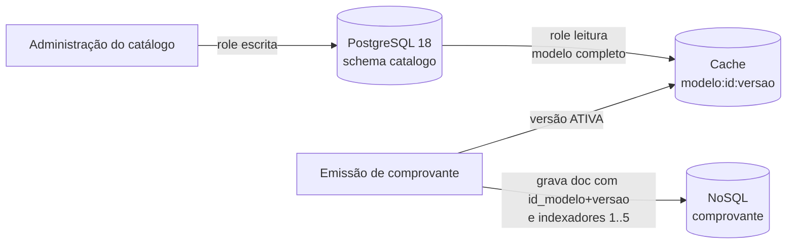

## Context

O receiptsio separa a persistência em duas divisões:



O documento base (`docs/modelagem-dados-para-modelo-de-comprovante.txt` + `docs/cardinalidade-modelo-comprovante.png`) define seis tabelas: `modelo`, `campos`, `template estrutural`, `template estrutural relacionamento campos`, `template variavel`, `template variavel relacionamento campos`, com 1:N de cada template para modelo e N:N campo↔template via associação.

`infra/local/postgres` veio de outro projeto (domínio `autorizacoes`) e hoje não sobe limpo: `v1.0.10` ordena antes de `v1.0.2`, `v1.0.9` exige `psql -v senha_...` (indisponível no entrypoint, aborta com `ON_ERROR_STOP`), e os nomes globais `postgres18-kiq`/`postgres_pg_data`/`postgres_default` colidem com o projeto de origem.

Decisões confirmadas pelo usuário na exploração: indexadores são chaves de busca do comprovante no NoSQL (posição importa); versão publicada é imutável e o comprovante guarda `(id_modelo, versao)`; manter as três extensões; o mesmo campo pode estar nos dois templates; a infra legada é descartável.

## Goals / Non-Goals

**Goals:**
- Schema do catálogo fiel ao modelo base, com as correções de integridade listadas em D2–D9.
- Regras de negócio impostas pelo banco (constraint, FK, trigger), não só pela aplicação futura.
- Subida local reprodutível com volume vazio e isolada de outros projetos.
- Prova executável das regras (script de verificação) contra o banco real.

**Non-Goals:**
- NoSQL, cache, aplicação Java, API de administração.
- Flyway/Liquibase ou migração incremental de banco existente (initdb só roda com volume vazio).
- Tuning de capacidade: catálogo é de baixa escrita e leitura servida pelo cache (ver Capacidade).

## Decisions

### D1. Schema dedicado `catalogo` e nomes de tabela
Tabelas no schema `catalogo` (não `public`): `campo`, `template_estrutural`, `template_estrutural_campo`, `template_variavel`, `template_variavel_campo`, `modelo`. `search_path` do banco inclui `catalogo, public`.
- *Por quê:* GRANTs por schema (`GRANT SELECT ON ALL TABLES IN SCHEMA catalogo` + `ALTER DEFAULT PRIVILEGES`) ficam triviais e não alcançam objetos de extensão em `public` (`cron.*`, partman).
- *Alternativa:* `public` como no projeto de origem — rejeitada pela granularidade de privilégio.
- Nomes de associação no singular `<template>_campo` em vez de "relacionamento campos" — mais curtos, mesma semântica.

### D2. `modelo` com PK composta e imutabilidade por situação
```
modelo (
  id_modelo              varchar(10)  CHECK (id_modelo ~ '^[A-Z0-9_]{1,10}$'),
  versao                 smallint     CHECK (versao BETWEEN 1 AND 999),
  descricao              text NOT NULL,
  situacao               text NOT NULL DEFAULT 'RASCUNHO' CHECK (situacao IN ('RASCUNHO','ATIVO','INATIVO')),
  id_template_estrutural uuid NOT NULL REFERENCES template_estrutural ON DELETE RESTRICT,
  id_template_variavel   uuid NOT NULL REFERENCES template_variavel   ON DELETE RESTRICT,
  version                bigint NOT NULL DEFAULT 0,
  data_hora_criacao / data_hora_atualizacao timestamptz,
  PRIMARY KEY (id_modelo, versao)
)
CREATE UNIQUE INDEX uk_modelo_ativo ON modelo (id_modelo) WHERE situacao = 'ATIVO';
```
- *Por quê PK composta:* no documento base `versao` existe mas a PK é só `id_modelo`, o que impede ter duas versões. O NoSQL referencia `(id_modelo, versao)`; essa tupla precisa ser chave e nunca mudar de significado.
- *Por quê `situacao` + índice parcial:* resolve "qual a versão vigente" com uma linha e garante no banco que existe no máximo uma.
- *Troca de vigente:* índice único parcial não é adiável; a troca exige inativar a antiga antes de ativar a nova na mesma transação (cenário da spec). *Alternativa:* `EXCLUDE ... WHERE (situacao='ATIVO') DEFERRABLE INITIALLY DEFERRED` — permite ordem livre, mas adiciona complexidade sem ganho real para um catálogo administrado; rejeitada.
- *Regex `[A-Z0-9_]`:* `varchar(10)` limita caracteres, não bytes; restringir a ASCII garante os "10 bytes" do documento base.
- `versao` smallint: 1..999 cabe com folga.

### D3. Imutabilidade imposta por trigger
- `trg_modelo_imutavel` (BEFORE UPDATE em `modelo`): se `OLD.situacao <> 'RASCUNHO'`, só `situacao`, `version` e `data_hora_atualizacao` podem mudar; bloqueia transição para `RASCUNHO`. BEFORE DELETE: só exclui `RASCUNHO`.
- `trg_template_*_campo_imutavel` (BEFORE INSERT/UPDATE/DELETE nas associações) e BEFORE UPDATE/DELETE nos templates: rejeita se o template é referenciado por algum `modelo` com `situacao <> 'RASCUNHO'`.
- *Por quê no banco:* a garantia sustenta a integridade de comprovantes já gravados no NoSQL; uma aplicação futura ou um `UPDATE` manual não podem quebrá-la.
- *Alternativa:* coluna `situacao` também nos templates — rejeitada: duplica estado; "template publicado" é derivável de "referenciado por modelo publicado".
- Erros com `RAISE EXCEPTION ... USING ERRCODE = 'check_violation'` e mensagem que nomeia modelo/template, para a aplicação traduzir.

### D4. Indexadores como posição na associação
Remove `indexador_1..5` de `template_estrutural`. Em `template_estrutural_campo`:
```
posicao_indexador smallint NULL CHECK (posicao_indexador BETWEEN 1 AND 5),
UNIQUE (id_template_estrutural, posicao_indexador),          -- NULLs não colidem
CHECK (posicao_indexador IS NULL OR aceita_nulo_vazio = false)
```
- *Por quê:* o base tinha duas fontes de verdade (colunas texto no template + booleano na associação) que podiam divergir. Como indexadores são chaves de busca no NoSQL, a posição (1..5) é o dado relevante e passa a viver num só lugar, com FK real para `campo`.
- *Indexador 1 obrigatório:* validado na publicação (`RASCUNHO → ATIVO`) dentro de `trg_modelo_imutavel`, não por constraint trigger adiado por template. *Por quê:* um template é montado em vários passos; exigir a posição 1 em todo commit impediria rascunho incremental. Na publicação a regra fecha, e depois disso o template fica imutável (D3), então ela não pode ser quebrada.
- *Alternativa:* manter `indexador_1..5` como FK para `campo` — rejeitada: cinco FKs + coerência com a associação continuam sendo dois lugares.

### D5. Ordem dos campos
`ordem smallint NOT NULL CHECK (ordem > 0)` e `UNIQUE (id_template, ordem)` nas duas associações. O documento base não define ordem, mas a renderização do comprovante precisa dela.

### D6. Campo
```
campo (
  id_campo      bigint GENERATED ALWAYS AS IDENTITY PRIMARY KEY,
  nome_campo    text NOT NULL CHECK (btrim(nome_campo) <> ''),
  tipo_dado     text NOT NULL CHECK (tipo_dado IN ('TEXTO','INTEIRO','DECIMAL','DATA','DATA_HORA','BOOLEANO')),
  descricao_base text NOT NULL, ...
)
CREATE UNIQUE INDEX uk_campo_nome_tipo ON campo (lower(nome_campo), tipo_dado);
```
- "numérico 10 bytes" do base → `bigint` (8 bytes, até 9,2×10¹⁸), suficiente e nativo; `numeric(10)` seria mais lento e sem identity.
- *Domínio por CHECK vs tabela `tipo_dado`:* CHECK escolhido — lista pequena e estável; ampliar é uma migration de uma linha. Revisitar se o tipo ganhar atributos (máscara, tamanho).

### D7. UUIDv7 nativo
PKs de templates com `DEFAULT uuidv7()` (função nativa do PostgreSQL 18). Sem extensão `pg_uuidv7`/`uuid-ossp`. UUIDv7 é ordenado por tempo, então o índice B-tree não fragmenta como com v4.

### D8. Datas e fuso
`timestamptz NOT NULL DEFAULT now()` para criação e atualização; uma função `catalogo.fn_atualiza_data_hora()` reutilizada por trigger BEFORE UPDATE em todas as tabelas. `ALTER DATABASE ... SET timezone = 'America/Sao_Paulo'`.
- *Por quê não `timestamp` com "UTC-3":* `timestamptz` guarda o instante absoluto e só exibe no fuso da sessão; offset fixo não representa histórico de horário de verão e confunde a serialização para Java/NoSQL.

### D9. Lock otimista
`version bigint NOT NULL DEFAULT 0` em `modelo`, `template_estrutural`, `template_variavel`, `campo`, incrementado pela aplicação (padrão JPA `@Version`). *Sem* trigger de incremento: conflitaria com o `SET version = version + 1 WHERE version = ?` do Hibernate.

### D10. Infra: renomeação e numeração
| Item | De | Para |
|---|---|---|
| container | `postgres18-kiq` | `postgres18-receiptsio` |
| volume | `postgres_pg_data` | `receiptsio_pg_data` |
| rede | `postgres_default` | `receiptsio_postgres` |
| `DB_NAME` padrão | `db-csp-postgres` | `db-receiptsio` |
| imagem | `postgres18-kiq-extras-partman_cron_vector:1.0` | `postgres18-receiptsio-extras-partman_cron_vector:1.0` |

Porta do host continua `5432` (parametrizável por `DB_PORT:-5432`). `dockerfile` e `shared_preload_libraries` inalterados.

Numeração com dois dígitos no último componente (`v1.0.00` … `v1.0.99`), garantindo ordenação lexicográfica correta:
```
v1.0.00.-extensoes-schema-timezone-funcoes.sql
v1.0.01.-cria-tabela-campo.sql
v1.0.02.-cria-template-estrutural-e-campos.sql
v1.0.03.-cria-template-variavel-e-campos.sql
v1.0.04.-cria-tabela-modelo.sql
v1.0.05.-triggers-imutabilidade-e-publicacao.sql
v1.0.06.-roles-privilegio-minimo.sh
v1.0.07.-seed-modelo-exemplo.sql
```

### D11. Roles sem `psql -v` manual
`v1.0.06` é um `.sh` (o entrypoint executa `.sh` e `.sql` na mesma ordenação) que lê `DB_CATALOGO_LEITURA_PASSWORD` e `DB_CATALOGO_ESCRITA_PASSWORD` do ambiente do container e chama `psql -v ON_ERROR_STOP=1 -v senha=...` com `:'senha'`. O compose repassa as variáveis com `${VAR:?mensagem}`; `.env.example` documenta ambas.
- Roles: `catalogo_leitura` (USAGE no schema + SELECT) e `catalogo_escrita` (USAGE + SELECT/INSERT/UPDATE/DELETE + USAGE em sequences). Nenhum é owner; DDL fica com o superusuário do container.
- *Alternativa:* role sem senha + `ALTER ROLE` manual documentado — rejeitada: subida deixa de ser completa sozinha.
- *Alternativa:* senha fixa no SQL — rejeitada (segredo versionado).

### D12. Verificação
`infra/local/postgres/verificar-catalogo.sql`: cada cenário da spec num bloco `DO` que executa a operação, captura a exceção esperada (`unique_violation`, `check_violation`, `foreign_key_violation`, `not_null_violation`, `insufficient_privilege`) e registra `OK`/`FALHA` numa tabela temporária. Tudo dentro de `BEGIN … ROLLBACK`; ao final, `\if` sobre a contagem de falhas encerra com `\q 1`. Executado com `docker exec -i postgres18-receiptsio psql -v ON_ERROR_STOP=1 ... < verificar-catalogo.sql`. Cenários de privilégio usam `SET ROLE catalogo_leitura`/`catalogo_escrita`.

### Capacidade
Catálogo de baixa cardinalidade (estimativa: dezenas a centenas de modelos, algumas centenas de campos) e escrita administrativa rara. A leitura de produção vai para o cache com chave imutável `modelo:{id}:{versao}` (sem invalidação) e ponteiro `modelo:{id}:vigente` (TTL curto ou invalidação ao publicar). Índices: as PKs, os únicos descritos e um índice em `modelo(id_template_estrutural)`/`modelo(id_template_variavel)` para os triggers de D3 (busca "template referenciado por modelo publicado"). Limite de recursos do compose reduzido para `cpus: '1.0'`, `memory: 1G` (o valor anterior era dimensionado para 989 partições de `autorizacoes`).

## Risks / Trade-offs

- [Volume `postgres_pg_data` do projeto de origem continua na máquina] → não é tocado; README instrui `docker volume ls` e explica que o receiptsio usa `receiptsio_pg_data`.
- [Porta 5432 ocupada pelo outro projeto rodando em paralelo] → `DB_PORT` no `.env` permite trocar sem editar o compose.
- [Init só roda com volume vazio: mudar migration exige recriar o volume] → README documenta `down -v`; aceitável em ambiente local; Flyway fica para quando houver app.
- [Triggers de imutabilidade adicionam custo a cada escrita em associação] → escrita é rara e administrativa; consulta usa os índices de FK de `modelo`.
- [Regra "indexador 1" só vale na publicação; rascunho pode ficar sem ela] → intencional (D4); a consulta de modelo completo deve ser usada pelo cache só para versões publicadas.
- [Domínio de `tipo_dado` por CHECK] → ampliar exige migration; aceitável pela estabilidade da lista.
- [Senhas de roles no ambiente do container (`docker inspect` as mostra)] → ambiente local; em nuvem, segredo gerenciado (fora de escopo).

## Migration Plan

1. `docker compose ... down` do ambiente antigo, se estiver rodando com nomes legados (não remover o volume legado).
2. Atualizar `.env` a partir do novo `.env.example` (`DB_NAME`, senhas dos roles).
3. `docker compose --env-file ../../../.env -f postgres-db-v18.yml up -d --build`.
4. Executar `verificar-catalogo.sql` e conferir código de saída 0.

Rollback: `down -v` remove apenas `receiptsio_pg_data`; o histórico git restaura a infra antiga.

## Decisões Resolvidas (na exploração)

- ✓ **Indexadores não precisam ser contíguos**, apenas a posição 1 é obrigatória na publicação (como no documento base). Implementado: `posicao_indexador SMALLINT NULL CHECK (posicao_indexador BETWEEN 1 AND 5)`.
- ✓ **Lista de `tipo_dado`**: `TEXTO`, `INTEIRO`, `DECIMAL`, `DATA`, `DATA_HORA`, `BOOLEANO`, `UUID`. Implementado no CHECK de `v1.0.01`.
- ✓ **`descricao` é opcional** (`NOT NULL` removido) em todas as tabelas. Implementado: `descricao_base TEXT,` sem constraint.
