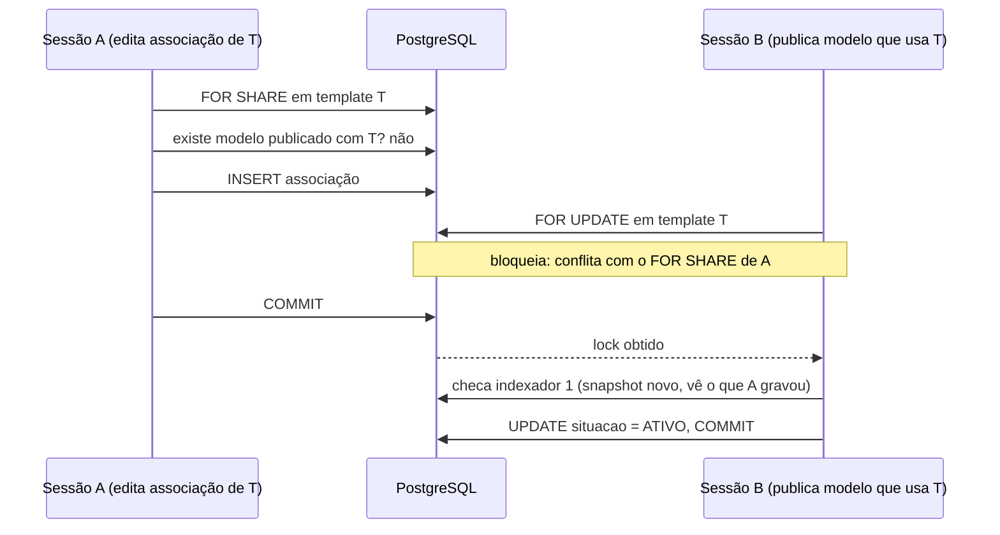

## Context

O catálogo relacional (schema `catalogo`, PostgreSQL 18 local) foi criado pela change arquivada `2026-10-09-criar-banco-catalogo-modelos-comprovante` (decisões D1–D12 do design dela). Em 2026-11-22 as migrations foram executadas num container descartável. O resultado está em `infra/local/postgres/explicacao.md`:

| Grupo | Achado |
|---|---|
| Subida | B1: `UNIQUE (LOWER(...))` dentro de `CREATE TABLE` é erro de sintaxe. B2: `run_sql` descarta `-v senha_...`. |
| Imutabilidade | I1: `INSERT` direto como `ATIVO` pula o indexador 1. I2: o campo em uso pode mudar nome e tipo. I3: a PK do modelo publicado pode mudar. I4: publicar e editar o template ao mesmo tempo deixa o template alterado depois da validação (*write skew*). I5: `data_hora_criacao` pode mudar. |
| Cache | A consulta de modelo completo faz produto cartesiano entre as associações. |
| Prova | `verificar-catalogo.sql` aborta e, quando roda, termina com 0 mesmo com falhas. |
| Aderência a `docs/` | Faltam `descricao` nos templates, `descricao campo em template` e as datas nas associações. |

Durante a exploração (registrada no histórico da conversa), o dono do produto decidiu:

- renomear `version` → `data_version`;
- **nenhum trigger de auditoria**: a aplicação atualiza `data_hora_atualizacao`. Os triggers de imutabilidade continuam;
- templates com `nome_template` obrigatório e `descricao` opcional;
- associações com `descricao_campo_template` opcional e datas, sem `data_version`;
- um seed com PIX, TED e Boleto para inspeção.

Nenhum volume `receiptsio_pg_data` existe na máquina: o banco atual nunca subiu, então não há dado a migrar.

## Goals / Non-Goals

**Goals:**

- O catálogo sobe limpo com `docker compose` e volume vazio.
- A imutabilidade da versão publicada é garantida pelo banco contra qualquer cliente, inclusive sob concorrência.
- Prova executável que falha de verdade: SQLSTATE exato e código de saída ≠ 0.
- Esquema aderente a `docs/`, com os desvios conscientes registrados aqui.
- Seed que permite ao dono do produto inspecionar o modelo e exercitar o bloqueio de publicação manualmente.

**Non-Goals:**

- Aplicação Java, cache e NoSQL.
- Flyway/Liquibase. O init continua via `docker-entrypoint-initdb.d`.
- Tuning de desempenho: a carga é administrativa e rara (ver Capacidade).

## Decisions

### D1. Editar as migrations no lugar
v1.0.00 a v1.0.07 são corrigidas nos próprios arquivos; nenhuma v1.0.08+ é criada.
- *Por quê:* o init só roda com volume vazio, e nenhum ambiente chegou a subir com a versão atual. Uma migration incremental protegeria um estado que nunca existiu.
- *Alternativa:* criar v1.0.08 com `ALTER TABLE`. Rejeitada: o histórico ficaria com arquivos quebrados (v1.0.01 não executa).
- *Perda aceita:* o diff mostra uma reescrita, não uma evolução.
- *Gatilho de revisão:* existir algum ambiente com dados. A partir daí só entram migrations incrementais.

### D2. Lock otimista em `data_version`
`data_version BIGINT NOT NULL DEFAULT 0` em `campo`, `template_estrutural`, `template_variavel` e `modelo`. Nenhuma coluna se chama `version`. As associações não têm a coluna.
- *Por quê:* `modelo.versao` é dado de negócio (faz parte da chave lida pelo NoSQL); `version` ao lado dela convida ao erro. O JPA mapeia qualquer nome com `@Version @Column(name = "data_version")`.
- *Por que não nas associações:* a associação é editada pelo agregado template. A aplicação usa `OPTIMISTIC_FORCE_INCREMENT` no template ao incluir, alterar ou excluir associações, então o `data_version` do template protege o conjunto.
- *Alternativa:* `versao_registro`. Rejeitada pelo dono do produto: o prefixo `data_` deixa explícito que é controle técnico.
- *Perda aceita:* é a única coluna em inglês num esquema em português.

### D3. Datas de auditoria sem trigger (revisa D8 da change anterior)
`data_hora_criacao` e `data_hora_atualizacao` são `timestamptz NOT NULL DEFAULT now()` em **todas** as seis tabelas, incluindo as associações. A função `catalogo.fn_atualiza_data_hora()` e os seis triggers `trg_*_atualiza_data_hora` deixam de existir.
- No INSERT, o banco preenche as duas datas.
- No UPDATE, renovar `data_hora_atualizacao` é contrato da aplicação (`@UpdateTimestamp` ou valor explícito).
- `data_hora_criacao` fica protegida por **privilégio de coluna**: a role `catalogo_escrita` recebe `UPDATE` apenas nas colunas listadas de cada tabela, sem `data_hora_criacao`.
- *Por quê:* decisão do dono do produto. A data de atualização é dado de auditoria da aplicação, e um trigger esconde esse comportamento de quem lê o código.
- *Alternativa:* trigger `BEFORE UPDATE` com `now()`. Rejeitada.
- *Alternativa para I5:* trigger que copia `OLD.data_hora_criacao`. Rejeitada pela mesma decisão; o privilégio de coluna dá a mesma garantia sem trigger.
- *Perda aceita:* um `UPDATE` fora da aplicação (psql manual) deixa `data_hora_atualizacao` desatualizada. O superusuário ignora o privilégio de coluna.
- *Gatilho de revisão:* aparecer outro cliente de escrita além da aplicação de administração.
- `ALTER DEFAULT PRIVILEGES` não aceita lista de colunas. Por isso o `UPDATE` da role de escrita é concedido **tabela a tabela**, e a verificação confere que nenhuma tabela do schema dá `UPDATE` em `data_hora_criacao` a essa role.

### D4. Imutabilidade corrigida (revisa D3 da change anterior)
Os triggers de regra continuam no banco, porque protegem o NoSQL e o cache contra qualquer cliente. Erros usam `ERRCODE = 'check_violation'` (23514) e mensagem que nomeia modelo, template ou campo.

**Transições de `situacao`** ("publicado" = `ATIVO` ou `INATIVO`):

| De \ Para | RASCUNHO | ATIVO | INATIVO |
|---|---|---|---|
| (INSERT) | ok | valida publicação | valida publicação |
| RASCUNHO | ok | valida publicação | **rejeita** (nova) |
| ATIVO | rejeita | ok | ok |
| INATIVO | rejeita | ok | ok |

O trigger atual aceita `RASCUNHO → INATIVO` sem validar nada. A versão fica congelada sem indexador 1 e pode ir depois para `ATIVO` sem nova checagem. A spec anterior não lista essa transição como permitida, então ela passa a ser rejeitada.

**`fn_modelo_imutavel` (BEFORE INSERT OR UPDATE):**
- Em linha publicada (`OLD.situacao <> 'RASCUNHO'`), rejeita mudança de `id_modelo`, `versao` (I3), `descricao`, `id_template_estrutural` e `id_template_variavel`.
- "Validar publicação" (corrige I1 e I4), nesta ordem:
  1. `SELECT ... FOR UPDATE` na linha do template estrutural e do variável;
  2. `SELECT ... FOR SHARE` nas linhas de `campo` usadas pelos dois templates;
  3. checar que existe `posicao_indexador = 1`.

  Os locks vêm antes da checagem, para a checagem enxergar tudo o que foi confirmado.

**Triggers das associações (BEFORE INSERT/UPDATE/DELETE):**
- Primeiro `SELECT ... FOR SHARE` na linha do template; depois checam se existe modelo publicado que o referencia.
- No UPDATE checam o template de `OLD` **e** o de `NEW` (hoje só `NEW`, via `COALESCE`).

**Triggers dos templates (BEFORE UPDATE/DELETE):** mantidos. Template de modelo publicado é inteiramente congelado, inclusive `nome_template` e `descricao`.

**Novo `fn_campo_imutavel` (BEFORE UPDATE em `campo`, corrige I2):** rejeita mudança de `nome_campo` ou `tipo_dado` se o campo está em algum template referenciado por modelo publicado. `descricao_base` continua editável, porque não altera o significado de comprovantes gravados.

**Por que os locks fecham a corrida (I4):**

- No sentido inverso (B publica primeiro), o `FOR SHARE` de A espera o commit de B. A checagem de A, com snapshot novo, vê o modelo publicado e rejeita.
- Para o campo vale o mesmo raciocínio: o `UPDATE` de campo pega `FOR NO KEY UPDATE`, que conflita com o `FOR SHARE` da publicação. `FOR KEY SHARE`, que a FK já pega, **não** basta, porque não conflita com `UPDATE` que não mexe na chave.
- Isso funciona em `READ COMMITTED`, porque funções PL/pgSQL `VOLATILE` tiram snapshot novo a cada comando.
- *Alternativa:* `SERIALIZABLE`. Rejeitada: exige retry em toda transação da aplicação e não protege clientes em `READ COMMITTED`.
- *Alternativa:* advisory lock por template. Rejeitada: fica invisível no esquema e depende de todos os clientes seguirem a convenção.
- *Alternativa:* só o `OPTIMISTIC_FORCE_INCREMENT` da aplicação. Rejeitada: não protege psql nem outros clientes.
- *Perda aceita:* publicação e edição do mesmo template se serializam, com espera de milissegundos numa escrita rara. Há risco de deadlock se uma sessão editar um campo e depois um template enquanto outra publica; o PostgreSQL aborta uma delas (`40P01`) e a aplicação repete.

### D5. Descrições
- `template_estrutural` e `template_variavel`: `nome_template TEXT NOT NULL CHECK (btrim(nome_template) <> '')` e `descricao TEXT NULL`.
- `template_estrutural_campo` e `template_variavel_campo`: `descricao_campo_template TEXT NULL`. Quando nula, o rótulo efetivo é `campo.descricao_base`. A consulta de modelo completo devolve as duas descrições e a efetiva (`COALESCE`).
- `modelo.descricao` continua `NOT NULL`. A frase "descrição é opcional em todas as tabelas" do design anterior passa a valer só para as descrições citadas acima.
- *Por quê:* `docs/` pede `descricao` nos templates e `descricao campo em template` nas associações. O dono do produto escolheu manter também `nome_template` como rótulo curto obrigatório.
- *Alternativa:* só `descricao`, fiel ao `docs/`. Rejeitada pelo dono do produto.

### D6. Modelo completo como view
`catalogo.vw_modelo_completo`: uma linha por `(id_modelo, versao)`, com `campos_estruturais` e `campos_variaveis` em `jsonb` agregados em **subconsultas independentes**, ordenados por `ordem`.
- *Por quê:* a mesma definição é usada pelo carregador de cache, pelos exemplos e pela verificação. O bug de produto cartesiano não volta sem quebrar a prova. A role de leitura recebe `SELECT` pelos `GRANT ... ON ALL TABLES`, que incluem views.
- *Alternativa:* manter a consulta só em `exemplos-queries.sql`. Rejeitada: o texto do exemplo não é testado e foi exatamente onde o bug estava.
- *Perda aceita:* mais um objeto no schema; mudar o formato do JSON exige `CREATE OR REPLACE VIEW`.

### D7. Parametrização de banco e usuário
- Em `v1.0.00`, `ALTER DATABASE` passa a usar `current_database()`, via `DO` + `format('%I')`.
- Em `v1.0.06`, o `psql` usa `"$POSTGRES_USER"` e `"$POSTGRES_DB"`, que o entrypoint já exporta.
- `run_sql` repassa os argumentos extras ao `psql` (corrige B2).
- *Por quê:* o compose aceita `DB_NAME` e `DB_USER_NAME` pelo `.env`, mas as migrations tinham `db-receiptsio`/`docker` fixos.

### D8. Limpezas
- Remove a constraint `UNIQUE` com expressão de `campo` (corrige B1); a regra fica no `uk_campo_nome_tipo` que já existe.
- Remove `ix_template_estrutural_campo_template` e `ix_template_variavel_campo_template`, redundantes com a coluna inicial da PK.
- Alinha o comentário de `template_variavel_campo.aceita_nulo_vazio` ao padrão `false` (obrigatório). O seed informa `true` quando o campo é opcional.

### D9. Verificação reescrita
`verificar-catalogo.sql`:
- Duas funções temporárias (`pg_temp`):
  - `esperar_erro(cenario, descricao, sql, sqlstate)` executa `sql` dinamicamente e marca `OK` só se o erro tiver exatamente aquele SQLSTATE. Erro diferente ou ausência de erro vira `FALHA`, com o SQLSTATE e a mensagem obtidos.
  - `esperar_sucesso(cenario, descricao, sql)` marca `FALHA` com a mensagem se der qualquer erro.
- Cada cenário roda em subtransação (bloco de exceção) e usa dados próprios prefixados (`VER_`), sem colidir com o seed.
- Ao final: `SELECT count(*) FILTER (WHERE status = 'FALHA') > 0 AS tem_falha \gset`, `ROLLBACK`, e `\if :tem_falha` dispara um erro SQL deliberado (`RAISE EXCEPTION`) com `ON_ERROR_STOP` ligado, que encerra o psql com código 3. *Por quê:* o `\q` do psql não aceita código de saída (`\q 1` imprime `extra argument "1" ignored` e sai com 0; o script original tinha esse defeito, descoberto na prova RED).
- Cenários de privilégio usam `SET LOCAL ROLE`.
- A prova negativa remove uma regra numa sessão manual e confere `FALHA` e código ≠ 0.

`verificar-concorrencia.sh`, executado no host e falando com o container via `docker exec`:
- duas sessões `psql` nos dois sentidos (edita-depois-publica e publica-depois-edita), com `pg_sleep` para forçar a sobreposição;
- verifica que nenhum modelo `ATIVO` ficou com template alterado depois da validação;
- termina com código ≠ 0 se a corrida passar.

Como os commits são reais e modelo publicado não pode ser excluído, a limpeza roda como superusuário com `SET session_replication_role = replica`, que desliga os triggers só naquela sessão, e usa o prefixo `CONC_`.

### D10. Seed de inspeção (`v1.0.07`)

| Modelo | Versão | Situação | Templates | O que demonstra |
|---|---|---|---|---|
| `COMPPIX` | 1 | INATIVO | próprios | versão retirada continua imutável |
| `COMPPIX` | 2 | ATIVO | próprios (v1 + campo novo) | evoluir uma versão exige novos templates |
| `COMPPIX` | 3 | RASCUNHO | próprios | rascunho editável; tem indexador 1, então pode ser publicado |
| `COMPTED` | 1 | ATIVO | estrutural com indexadores 1 a 5 | as 5 posições |
| `COMPBOL` | 1 | ATIVO | estrutural só com indexador 1 | mínimo publicável |
| `COMPBOL` | 2 | RASCUNHO | estrutural com indexador 2, **sem o 1** | a publicação manual deve falhar |

- Campos como `valor`, `data_hora_transacao` e `instituicao_pagador` aparecem em vários modelos; ao menos um campo aparece no estrutural e no variável do mesmo modelo.
- Algumas associações usam `descricao_campo_template` e outras deixam nula, para mostrar o fallback.
- Os modelos publicados são inseridos já com a situação final. A regra de D4 valida o indexador 1 também no INSERT, então os templates são populados antes.

### Capacidade
Mantém a estimativa da change anterior, que é uma **hipótese**: dezenas a centenas de modelos, centenas de campos, escrita administrativa rara e leitura de produção servida pelo cache. Os locks de D4 seguram poucas linhas por milissegundos. Container com `cpus: 1.0` e `memory: 1G`. Nenhum número desta change foi medido sob carga, e nenhum precisa ser.

### Consistência por operação

| Operação | Exigência | Garantia |
|---|---|---|
| Publicar / editar template / editar campo | forte e serializada | triggers + locks de linha (D4) |
| Trocar versão vigente | no máximo 1 ATIVO | índice único parcial (inalterado) |
| Atualizar `data_hora_atualizacao` | melhor esforço da aplicação | contrato da aplicação (D3) |
| Carregar modelo para cache | exata por `(id, versao)` | view (D6) sobre dados imutáveis |

## Risks / Trade-offs

- [A aplicação esquece de atualizar `data_hora_atualizacao`] → a data fica igual à de criação. Mitigação: contrato documentado no README e no comentário da coluna; teste de integração na futura aplicação.
- [Tabela nova não recebe `UPDATE` por coluna na role de escrita] → a escrita falha com `permission denied`, o que é visível e não silencioso. A verificação lista as tabelas do schema e confere os privilégios de coluna.
- [Deadlock entre publicar e editar campo/template] → o PostgreSQL aborta uma transação (`40P01`); a aplicação repete. A escrita rara torna isso improvável.
- [`session_replication_role = replica` no teste de concorrência] → restrito ao superusuário, a uma sessão e a dados `CONC_`. Nunca aparece em migration nem em código de aplicação.
- [Mudança de nome de coluna (`data_version`) e remoção de triggers] → não há consumidores: nenhum código em `apps/` ou `libs/` referencia `version`.
- [`descricao_campo_template` nula] → o consumidor precisa aplicar o fallback. A view já entrega a descrição efetiva.
- [Porta 5432 ocupada na máquina] → `DB_PORT` no `.env`.

## Migration Plan

1. Conferir que `receiptsio_pg_data` não existe (`docker volume ls`). Se existir, `down -v`; não há dado válido nele.
2. Editar as migrations, a verificação, os exemplos e a documentação.
3. `docker compose --env-file ../../../.env -f postgres-db-v18.yml up -d --build` e aguardar `healthy`.
4. Rodar `verificar-catalogo.sql` e `verificar-concorrencia.sh`; ler as saídas e os códigos de saída.
5. Entregar o ambiente rodando com o seed para inspeção do dono do produto.

Rollback: `down -v` e `git revert` da change.

## Open Questions

Nenhuma bloqueante. Ficam registradas para a futura aplicação:
- se `descricao_base` de campo em uso pode mudar sem nova versão de modelo (hoje: pode);
- se a aplicação vai expor "copiar template" para facilitar a evolução de versão (D10).
